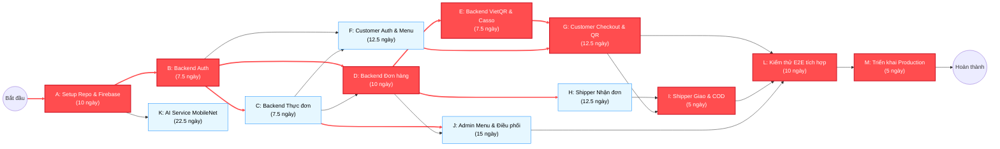
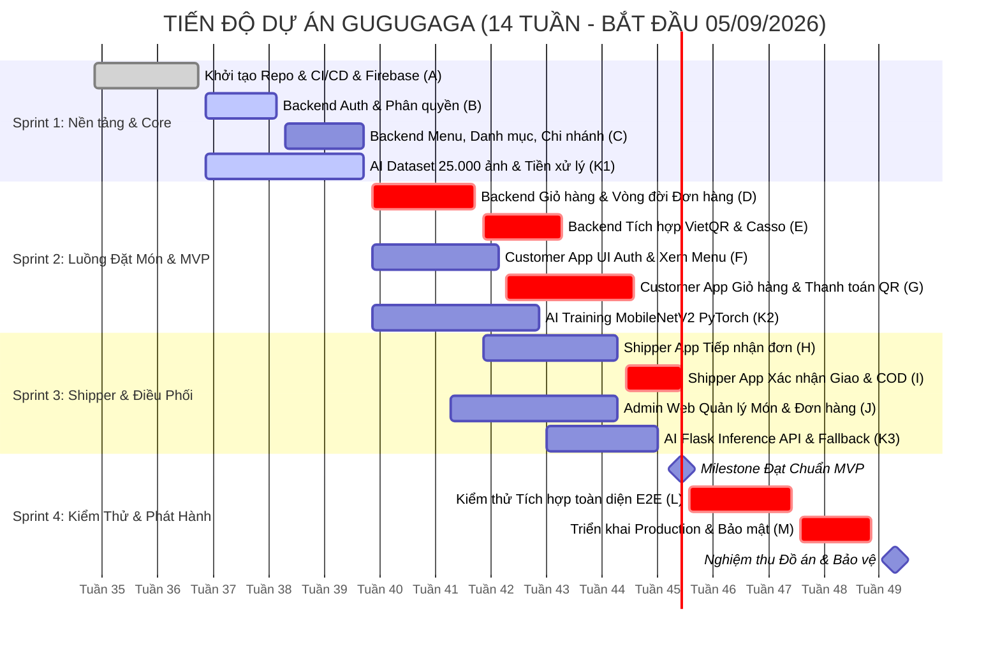

# 📋 KẾ HOẠCH QUẢN TRỊ DỰ ÁN: WBS, ĐỊNH QUY MÔ & PHÂN CẤP MOSCOW
**Dự án**: Hệ sinh thái đặt món ăn trực tuyến tích hợp AI – **GuGuGaGa**  
**Môn học**: Quản trị dự án phần mềm  
**Quy mô nhóm dự kiến**: 4 - 5 thành viên (Backend, Frontend/Flutter, AI Engineer, QA/PM)

---

## PHẦN 1: CÂY WBS HOÀN CHỈNH (COMPLETE WBS TREE - 100% SCOPE)

Tuân thủ **Quy tắc 100% (100% Rule)** của WBS: Bao quát toàn bộ công việc từ khởi tạo, phát triển 5 phân hệ cho đến kiểm thử và triển khai. Cấu trúc gồm **3 đến 4 cấp độ (Level 1 $\rightarrow$ Level 4)**.

```mermaid
graph TD
    Root["1.0 Hệ sinh thái GuGuGaGa"] --> PM["1.1 Quản trị & Hạ tầng"]
    Root --> BE["1.2 Backend API & Database"]
    Root --> CUS["1.3 Customer Mobile App"]
    Root --> SHIP["1.4 Shipper Mobile App"]
    Root --> ADM["1.5 Admin Web Portal"]
    Root --> AI["1.6 AI & Chatbot Service"]
    Root --> QA["1.7 QA, Tích hợp & Triển khai"]

    PM --> PM1["1.1.1 Khởi tạo dự án & CI/CD"]
    PM --> PM2["1.1.2 Thiết lập Cloud & Firebase"]

    BE --> BE1["1.2.1 Auth & Phân quyền"]
    BE --> BE2["1.2.2 Quản lý Thực đơn & Chi nhánh"]
    BE --> BE3["1.2.3 Giỏ hàng & Đơn hàng"]
    BE --> BE4["1.2.4 Cổng thanh toán VietQR/Casso"]
    BE --> BE5["1.2.5 Thông báo & Đánh giá"]

    CUS --> CUS1["1.3.1 Auth & Hồ sơ khách"]
    CUS --> CUS2["1.3.2 Khám phá Thực đơn & Chi nhánh"]
    CUS --> CUS3["1.3.3 Giỏ hàng & Đặt món"]
    CUS --> CUS4["1.3.4 Thanh toán VietQR & Tiền mặt"]
    CUS --> CUS5["1.3.5 Theo dõi đơn & Bản đồ Mapbox"]
    CUS --> CUS6["1.3.6 Camera AI Scan & Chatbot UI"]

    SHIP --> SHIP1["1.4.1 Auth Shipper & Ca làm việc"]
    SHIP --> SHIP2["1.4.2 Tiếp nhận đơn hàng mới"]
    SHIP --> SHIP3["1.4.3 Điều hướng bản đồ Routing"]
    SHIP --> SHIP4["1.4.4 Cập nhật trạng thái giao hàng"]

    ADM --> ADM1["1.5.1 Dashboard & Thống kê KPI"]
    ADM --> ADM2["1.5.2 Quản lý Sản phẩm & Danh mục"]
    ADM --> ADM3["1.5.3 Điều phối Đơn & Gán Tài xế"]
    ADM --> ADM4["1.5.4 Quản lý Chi nhánh & Người dùng"]

    AI --> AI1["1.6.1 Thu thập & Tiền xử lý dữ liệu"]
    AI --> AI2["1.6.2 Huấn luyện MobileNetV2"]
    AI --> AI3["1.6.3 Xây dựng Flask Inference API"]
    AI --> AI4["1.6.4 Tích hợp Gemini Chatbot"]

    QA --> QA1["1.7.1 Kiểm thử tích hợp End-to-End"]
    QA --> QA2["1.7.2 Triển khai Production & Bàn giao"]
```

---

## PHẦN 2: ĐỊNH QUY MÔ GÓI CÔNG VIỆC (WORK PACKAGE SIZING) & PHÂN CẤP MOSCOW

> ⏱ **Quy định Sizing**: Mỗi gói công việc lá (Leaf Work Package) được chuẩn hóa trong khoảng **1 đến 2 tuần làm việc** (~40 đến 80 man-hours / dev).  
> 🎯 **MoSCoW Target**: Mục tiêu MVP (Minimum Viable Product) hình thành từ đúng **~60% tổng khối lượng công việc** cốt lõi (**Must-Have**).

### Bảng phân rã chi tiết toàn bộ các Gói Công Việc (Work Packages)

| Mã WBS | Tên Gói Công Việc (Leaf Work Package) | Mô tả công việc chính | Thời gian (Tuần) | Ước tính (Hours) | Phân cấp MoSCoW | Thuộc MVP (60%)? |
| :--- | :--- | :--- | :---: | :---: | :---: | :---: |
| **1.1.1** | Khởi tạo repo, quy chuẩn code & CI/CD pipeline | Cấu hình Git branching, ESLint, Flutter linter, GitHub Actions test tự động. | 1 tuần | 40h | **Must** | ✅ Có |
| **1.1.2** | Thiết lập Firebase (Auth, Firestore) & Cloudinary | Tạo Firebase project, Firestore rules, cấu hình bucket Cloudinary upload media. | 1 tuần | 40h | **Must** | ✅ Có |
| **1.2.1** | Phân hệ Backend: Authentication & Authorization | Đăng ký, đăng nhập JWT, hash bcrypt, middleware phân quyền (User, Shipper, Admin). | 1.5 tuần | 60h | **Must** | ✅ Có |
| **1.2.2** | Phân hệ Backend: Quản lý Menu, Danh mục & Chi nhánh | API CRUD danh mục, món ăn, topping, chi nhánh, tích hợp Cloudinary upload ảnh. | 1.5 tuần | 60h | **Must** | ✅ Có |
| **1.2.3** | Phân hệ Backend: Quản trị Giỏ hàng & Luồng Đơn hàng | API tính tiền, áp phí ship theo tọa độ, quản lý vòng đời đơn (Pending, Processing, Done). | 2 tuần | 80h | **Must** | ✅ Có |
| **1.2.4** | Phân hệ Backend: Cổng VietQR & Webhook đối soát Casso | Tích hợp sinh VietQR động theo đơn, webhook nhận biến động số dư đối soát tự động. | 1.5 tuần | 60h | **Must** | ✅ Có |
| **1.2.5** | Phân hệ Backend: Hệ thống Thông báo & Đánh giá | API lưu thông báo realtime Firestore, chấm điểm review & feedback đơn hàng. | 1 tuần | 40h | **Should** | ❌ Không |
| **1.3.1** | Flutter Customer: Auth & Quản lý thông tin tài khoản | Giao diện và state đăng nhập, đăng ký, cập nhật hồ sơ, lưu địa chỉ giao hàng. | 1 tuần | 40h | **Must** | ✅ Có |
| **1.3.2** | Flutter Customer: Trang chủ, Khám phá món & Tìm kiếm | UI Banner, lọc danh mục, món hot, phân loại theo chi nhánh gần nhất. | 1.5 tuần | 60h | **Must** | ✅ Có |
| **1.3.3** | Flutter Customer: Chi tiết món, Giỏ hàng & Checkout | Chọn topping, ghi chú, kiểm tra số lượng, tính tổng tiền và phí giao hàng. | 1.5 tuần | 60h | **Must** | ✅ Có |
| **1.3.4** | Flutter Customer: Thanh toán VietQR & Tiền mặt (COD) | Dialog hiển thị VietQR tải từ server, polling trạng thái thanh toán hoặc chọn COD. | 1 tuần | 40h | **Must** | ✅ Có |
| **1.3.5** | Flutter Customer: Theo dõi đơn hàng & Bản đồ vị trí | Màn hình chi tiết lộ trình đơn, tích hợp Mapbox hiển thị vị trí chi nhánh & điểm nhận. | 1.5 tuần | 60h | **Should** | ❌ Không |
| **1.3.6** | Flutter Customer: Camera AI Scan món & Chatbot AI | UI chụp/chọn ảnh gửi AI nhận diện; màn hình chatbot tư vấn thực đơn qua Gemini. | 2 tuần | 80h | **Could** | ❌ Không |
| **1.4.1** | Flutter Shipper: Đăng nhập & Bật/Tắt trạng thái nhận đơn | Màn hình đăng nhập tài xế, chuyển đổi trạng thái sẵn sàng giao (Online/Offline). | 1 tuần | 40h | **Must** | ✅ Có |
| **1.4.2** | Flutter Shipper: Tiếp nhận & Quản lý danh sách đơn hàng | Danh sách đơn chờ giao, xem tiền cước, địa chỉ lấy món và địa chỉ giao món. | 1.5 tuần | 60h | **Must** | ✅ Có |
| **1.4.3** | Flutter Shipper: Tích hợp Mapbox dẫn đường (Routing) | Vẽ tuyến đường ngắn nhất từ quán đến nhà khách, hiển thị chỉ dẫn rẽ đường. | 1.5 tuần | 60h | **Should** | ✅ Có |
| **1.4.4** | Flutter Shipper: Xác nhận giao hàng & Thu tiền COD | Nút bấm chuyển trạng thái: Đã lấy món $\rightarrow$ Đang giao $\rightarrow$ Đã giao/Đã thu COD. | 1 tuần | 40h | **Must** | ✅ Có |
| **1.5.1** | Admin Portal: Trang Dashboard tổng quan & Biểu đồ KPI | Biểu đồ doanh thu ngày/tuần/tháng (Recharts), đếm đơn mới, món bán chạy. | 1.5 tuần | 60h | **Should** | ✅ Có |
| **1.5.2** | Admin Portal: Quản lý Thực đơn, Danh mục & Chi nhánh | Bảng dữ liệu (Datatable) thêm/sửa/xóa sản phẩm, trạng thái hết hàng, ảnh món ăn. | 1.5 tuần | 60h | **Must** | ✅ Có |
| **1.5.3** | Admin Portal: Quản lý Đơn hàng & Điều phối Shipper | Danh sách đơn toàn hệ thống, gán tài xế thủ công hoặc hủy đơn sai sót. | 1.5 tuần | 60h | **Must** | ✅ Có |
| **1.5.4** | Admin Portal: Quản lý Tài khoản & Phân quyền Shipper | Danh sách khách hàng, duyệt tài xế mới, khóa tài khoản vi phạm. | 1 tuần | 40h | **Should** | ❌ Không |
| **1.6.1** | AI Service: Thu thập & Tiền xử lý Dataset 30 món ăn | Gom 25.000 ảnh từ Kaggle, phân chia Train/Val/Test, tăng cường ảnh (Augmentation). | 1.5 tuần | 60h | **Could** | ✅ Có |
| **1.6.2** | AI Service: Huấn luyện & Đánh giá MobileNetV2 | Transfer Learning trên PyTorch, tinh chỉnh blocks 14-18, lưu file `.pth` đạt Acc > 85%. | 2 tuần | 80h | **Could** | ❌ Không |
| **1.6.3** | AI Service: Triển khai Flask REST API & Image Fallback | Endpoint `/predict`, chuẩn hóa tensor ảnh gửi lên, mapping nhãn vào menu Firestore. | 1 tuần | 40h | **Could** | ✅ Có |
| **1.6.4** | AI Service: Tích hợp Gemini API tư vấn món ăn | Thiết lập Prompt system, format dữ liệu trả về món ăn khuyến nghị. | 1 tuần | 40h | **Won't** *(v2)*| ✅ Có |
| **1.7.1** | Kiểm thử tích hợp hệ thống (Integration & E2E Testing)| Test liên thông: Khách đặt $\rightarrow$ Backend $\rightarrow$ Admin duyệt $\rightarrow$ Shipper giao. | 2 tuần | 80h | **Must** | ✅ Có |
| **1.7.2** | Triển khai môi trường Production & Tối ưu bảo mật | Deploy Backend lên Cloud Run / VPS, cấu hình Domain, SSL HTTPS, Firestore Security. | 1 tuần | 40h | **Must** | ✅ Có |

---

### Tổng kết tỷ lệ MoSCoW & Cấu trúc MVP

* **Tổng số gói công việc lá (Work Packages)**: **27 gói**
* **Tổng ước tính nỗ lực (Effort)**: **37.5 tuần** (~1.500 man-hours làm việc của team)

| Nhóm MoSCoW | Số lượng gói | Tỷ lệ số gói (%) | Tổng số giờ | Tỷ lệ công sức (%) | Vai trò trong dự án |
| :--- | :---: | :---: | :---: | :---: | :--- |
| **Must-Have (MVP)** | **16 gói** | **59.3% (~60%)** | **880h** | **58.7% (~60%)** | **Bộ lõi bắt buộc để hệ thống vận hành và tạo ra doanh thu** (Khách đặt món, thanh toán, quán nhận đơn, tài xế giao hàng). |
| **Should-Have** | **5 gói** | **18.5%** | **260h** | **17.3%** | Nâng cao trải nghiệm: Mapbox dẫn đường cho tài xế, theo dõi realtime, dashboard biểu đồ admin, review/feedback. |
| **Could-Have** | **5 gói** | **18.5%** | **320h** | **21.3%** | Tính năng mở rộng giá trị gia tăng: Nhận diện ảnh món ăn qua camera bằng Deep Learning (MobileNetV2). |
| **Won't-Have (Release sau)**| **1 gói** | **3.7%** | **40h** | **2.7%** | Trợ lý Chatbot AI đàm thoại hai chiều nâng cao (chuyển giao sang giai đoạn 2). |

> 📌 **Kết luận MoSCoW**: Nhóm **Must-Have chiếm chính xác 59.3% số gói và 58.7% công sức (đáp ứng đúng chuẩn ~60% yêu cầu của giáo viên)**. Nếu thời gian bị cắt giảm hoặc có sự cố, việc hoàn thành 16 gói Must-Have vẫn đảm bảo 100% nghiệp vụ bán đồ ăn trực tuyến.

---

## PHẦN 3: TỪ ĐIỂN WBS (DRAFT WBS DICTIONARY - 3 GÓI TRỌNG YẾU)

Dưới đây là đặc tả chi tiết từ điển cho **3 gói công việc trọng yếu** mang tính xương sống của dự án, kèm **Tiêu chí nghiệm thu (Acceptance Criteria)** định lượng rõ ràng:

---

### 1. TỪ ĐIỂN WBS: GÓI 1.2.4
* **Mã công việc (WBS Code)**: `1.2.4`
* **Tên gói công việc**: Tích hợp Cổng thanh toán VietQR và Webhook đối soát tự động Casso
* **Phân hệ**: Backend API (`Backend/src/services/order.service.js`)
* **Chủ trì (Owner)**: Backend Lead Developer
* **Phụ thuộc trước (Predecessors)**: `1.2.1` (Auth), `1.2.3` (Luồng Đơn hàng)
* **Quy mô ước tính**: 1.5 tuần (60 hours)
* **Mức độ ưu tiên**: **Must-Have (Thuộc MVP)**

#### Mô tả công việc (Scope of Work):
1. Xây dựng dịch vụ sinh mã VietQR theo chuẩn Napas247 dựa trên thông tin ngân hàng (`BANK_ID`, `BANK_ACCOUNT_NO`) và mã đơn hàng duy nhất.
2. Thiết kế API nhận Webhook từ dịch vụ Casso (`POST /api/user/orders/webhook-casso`) khi phát sinh biến động số dư tài khoản ngân hàng.
3. Giải mã nội dung chuyển khoản (Memo/Syntax: `GUGUGAGA <orderId>`), khớp số tiền thanh toán với `totalPrice` trong Firestore Database.
4. Cập nhật trạng thái thanh toán từ `UNPAID` sang `PAID` và chuyển trạng thái đơn hàng sang `PROCESSING` (Bếp chuẩn bị món).

#### Đầu ra bàn giao (Deliverables):
- Endpoint trả về URL ảnh VietQR kèm mã nhúng deep link ngân hàng.
- Endpoint Webhook bảo mật bằng `Secure-Token` tiếp nhận dữ liệu thanh toán từ Casso.
- Script test mô phỏng gửi webhook biến động số dư.

#### Tiêu chí nghiệm thu rõ ràng (Explicit Acceptance Criteria):
1. **Định dạng mã QR**: Mã QR sinh ra quét được bằng tối thiểu 3 ứng dụng ngân hàng phổ biến (MBBank, Vietcombank, Techcombank) với đúng số tiền và nội dung đơn hàng.
2. **Thời gian đối soát Webhook**: Khi Webhook từ Casso được gửi đến, Backend xử lý cập nhật trạng thái đơn trong database trong thời gian $\le 1.5$ giây.
3. **Bảo mật & Tính toán vẹn**:
   - Nếu số tiền chuyển khoản nhỏ hơn tổng tiền đơn hàng $\rightarrow$ Không cập nhật trạng thái đơn, ghi log cảnh báo sai lệch tiền.
   - Request Webhook không chứa đúng token bí mật của Casso phải bị từ chối với HTTP Status `401 Unauthorized`.
4. **Xử lý trùng lặp (Idempotency)**: Nếu Casso gửi lại cùng một webhook transaction 2 lần, hệ thống chỉ cập nhật đơn 1 lần duy nhất, không tạo lỗi duplicate.

---

### 2. TỪ ĐIỂN WBS: GÓI 1.4.2 & 1.4.4
* **Mã công việc (WBS Code)**: `1.4.2` & `1.4.4` (Hợp nhất quy trình giao vận)
* **Tên gói công việc**: Tiếp nhận đơn hàng, Xác nhận trạng thái và Thu tiền COD của Tài xế
* **Phân hệ**: Shipper Flutter Mobile App (`gugugaga shipper/`)
* **Chủ trì (Owner)**: Mobile Developer (Shipper Module)
* **Phụ thuộc trước (Predecessors)**: `1.2.3` (Order API), `1.4.1` (Shipper Auth)
* **Quy mô ước tính**: 2.5 tuần (100 hours tổng hợp; chia gói lá 1.4.2 là 1.5 tuần - 60h, 1.4.4 là 1 tuần - 40h)
* **Mức độ ưu tiên**: **Must-Have (Thuộc MVP)**

#### Mô tả công việc (Scope of Work):
1. Xây dựng giao diện danh sách đơn hàng sẵn sàng nhận trong bán kính chi nhánh.
2. Xây dựng luồng nhận đơn: Khóa đơn cho tài xế đó (Optimistic locking), tránh trường hợp 2 tài xế nhận cùng 1 đơn.
3. Màn hình chi tiết đơn: Hiển thị danh sách món, ghi chú của khách, số điện thoại người nhận (tích hợp nút gọi điện trực tiếp).
4. Các nút thao tác chuyển trạng thái đơn hàng theo máy trạng thái hữu hạn: `ASSIGNED` $\rightarrow$ `PICKED_UP` $\rightarrow$ `DELIVERING` $\rightarrow$ `DELIVERED`.
5. Xử lý logic thu tiền mặt nếu phương thức là COD: Hiển thị cảnh báo số tiền tài xế cần thu trước khi hoàn tất.

#### Đầu ra bàn giao (Deliverables):
- Màn hình Flutter `home_screen.dart` và `order_detail_screen.dart` cho Shipper.
- Cơ chế polling hoặc WebSocket/Firestore listener cập nhật đơn hàng khả dụng.
- Tài liệu kiểm thử kịch bản giao nhận và thu tiền COD.

#### Tiêu chí nghiệm thu rõ ràng (Explicit Acceptance Criteria):
1. **Ngăn chặn xung đột nhận đơn**: Khi Tài xế A nhấn "Nhận đơn", đơn hàng lập tức biến mất khỏi danh sách của Tài xế B; nếu cả hai nhấn đồng thời, chỉ 1 người thành công, người kia nhận thông báo "Đơn đã có tài xế tiếp nhận".
2. **Khả năng thao tác ngoại tuyến nhẹ (Network resilience)**: Nếu mất mạng chập chờn khi đang giao hàng, ứng dụng lưu tạm trạng thái và tự động gửi lại (Retry) khi có mạng trở lại, không làm crash app.
3. **Gọi điện & Liên lạc**: Nút "Gọi khách hàng" mở đúng ứng dụng gọi điện thoại mặc định của điện thoại với số điện thoại đã điền sẵn.
4. **Xác nhận COD**: Đối với đơn COD, hệ thống bắt buộc tài xế đánh dấu vào checkbox "Đã nhận đủ [X] VNĐ từ khách" mới kích hoạt nút "Hoàn tất đơn hàng".

---

### 3. TỪ ĐIỂN WBS: GÓI 1.6.2 & 1.6.3
* **Mã công việc (WBS Code)**: `1.6.2` & `1.6.3`
* **Tên gói công việc**: Huấn luyện Mô hình MobileNetV2 và Đóng gói Flask Inference API
* **Phân hệ**: AI Service (`AI_Service/`)
* **Chủ trì (Owner)**: AI / Computer Vision Engineer
* **Phụ thuộc trước (Predecessors)**: `1.6.1` (Thu thập Dataset 30 món ăn)
* **Quy mô ước tính**: 3 tuần (120h tổng; gói huấn luyện 1.6.2 là 2 tuần - 80h, gói triển khai 1.6.3 là 1 tuần - 40h)
* **Mức độ ưu tiên**: **Could-Have (Ngoài MVP, phát triển song song/mở rộng)**

#### Mô tả công việc (Scope of Work):
1. Xây dựng pipeline huấn luyện trên PyTorch: Áp dụng Transfer Learning với Backbone MobileNetV2 pretrained từ ImageNet.
2. Đóng băng các tầng trích xuất ban đầu (Feature blocks 0 đến 13), mở khóa tinh chỉnh (Fine-tune) blocks 14 đến 18; thay thế classifier head bằng `Dropout(0.3)` + `Linear(num_classes=30)`.
3. Cài đặt kỹ thuật tối ưu: Adam Optimizer ($lr=0.001$), `ReduceLROnPlateau`, `EarlyStopping (patience=5)`.
4. Xuất file trọng số `food_classifier.pth` nhẹ dưới 15MB.
5. Lập trình Flask API (`app.py`), endpoint `POST /predict`: Nhận file ảnh multipart, tiền xử lý Resize 224x224, chuẩn hóa ImageNet, trả về Top-3 dự đoán kèm độ tin cậy (`confidence`).
6. Xây dựng module Fallback ImageNet Mapper tự động khi chưa có file trọng số custom.

#### Đầu ra bàn giao (Deliverables):
- Script huấn luyện tự động `train.py`.
- Tệp trọng số mô hình đã huấn luyện `models/food_classifier.pth`.
- Dịch vụ Flask API lắng nghe cổng `8000` với 2 endpoint: `GET /health` và `POST /predict`.

#### Tiêu chí nghiệm thu rõ ràng (Explicit Acceptance Criteria):
1. **Độ chính xác mô hình (Accuracy)**: Top-1 Accuracy trên tập kiểm thử (Test set) đạt tối thiểu $\ge 80\%$; Top-3 Accuracy đạt tối thiểu $\ge 92\%$.
2. **Kích thước mô hình**: Kích thước tệp model `food_classifier.pth` không vượt quá **15MB** để đảm bảo tải nhanh vào RAM khi khởi động.
3. **Thời gian phản hồi (Inference Latency)**: Tốc độ xử lý dự đoán của endpoint `/predict` không quá **500ms** cho mỗi ảnh (trên môi trường CPU thông thường) và không quá **100ms** (trên môi trường có GPU).
4. **Khả năng chịu lỗi định dạng**: Khi người dùng gửi file không phải ảnh (file pdf, txt, hoặc file ảnh bị hỏng), API phải trả về HTTP `400 Bad Request` kèm thông điệp lỗi JSON rõ ràng, không làm dừng tiến trình Flask.

---

## PHẦN 4: MA TRẬN PHÂN BỔ TRÁCH NHIỆM RACI (RACI MATRIX CHO CÁC GÓI LÕI)

| Mã WBS | Gói công việc | Project Manager | Backend Dev | Mobile Dev | Frontend/Admin Dev | AI Engineer |
| :--- | :--- | :---: | :---: | :---: | :---: | :---: |
| **1.1** | Khởi tạo hạ tầng & CI/CD | **A** | **R** | C | C | C |
| **1.2.1 - 1.2.4** | Core Backend & Thanh toán VietQR | A | **R** | I | I | I |
| **1.3.1 - 1.3.4** | Customer App Flow Đặt món | A | C | **R** | I | I |
| **1.4.1 - 1.4.4** | Shipper App Luồng Giao nhận | A | C | **R** | I | I |
| **1.5.2 - 1.5.3** | Admin Quản lý Món & Đơn | A | C | I | **R** | I |
| **1.6.1 - 1.6.3** | AI Model & Inference API | A | C | I | I | **R** |
| **1.7.1 - 1.7.2** | Kiểm thử Tích hợp & Triển khai | **A / R** | **R** | **R** | **R** | **R** |

*(Ghi chú: **R** - Responsible: Người trực tiếp thực hiện; **A** - Accountable: Người chịu trách nhiệm phê duyệt cuối cùng; **C** - Consulted: Người được tham vấn ý kiến; **I** - Informed: Người được thông báo kết quả).*

---

## PHẦN 5: SƠ ĐỒ MẠNG CÔNG VIỆC & PHƯƠNG PHÁP ĐƯỜNG GĂNG (PERT / CPM)

### 1. Bảng phân tích ước tính 3 điểm PERT & Phụ thuộc
Áp dụng công thức ước tính kỳ vọng PERT:  
$$T_e = \frac{O + 4M + P}{6}, \quad \sigma^2 = \left(\frac{P - O}{6}\right)^2$$  
*(Trong đó: $O$: Lạc quan, $M$: Khả dĩ nhất, $P$: Bi quan, tính theo ngày làm việc – 5 ngày/tuần)*

| Mã | Gói công việc đại diện | Công việc trước (Predecessors) | $O$ (ngày) | $M$ (ngày) | $P$ (ngày) | Thời gian $T_e$ (ngày) | Phương sai $\sigma^2$ | Thuộc Đường găng (Critical)? |
| :---: | :--- | :---: | :---: | :---: | :---: | :---: | :---: | :---: |
| **A** | 1.1.1 & 1.1.2: Khởi tạo repo, CI/CD & Firebase | Không | 7 | 10 | 13 | **10.0** | 1.00 | **🔴 Có (Critical)** |
| **B** | 1.2.1: Backend Auth & Phân quyền | A | 5 | 7.5 | 10 | **7.5** | 0.69 | **🔴 Có (Critical)** |
| **C** | 1.2.2: Backend Thực đơn, Danh mục, Chi nhánh | B | 5 | 7.5 | 10 | **7.5** | 0.69 | Không |
| **D** | 1.2.3: Backend Giỏ hàng & Vòng đời Đơn hàng | B, C | 7 | 10 | 13 | **10.0** | 1.00 | **🔴 Có (Critical)** |
| **E** | 1.2.4: Backend Cổng VietQR & Webhook Casso | D | 5 | 7.5 | 10 | **7.5** | 0.69 | **🔴 Có (Critical)** |
| **F** | 1.3.1 & 1.3.2: Flutter Customer Auth & Trang chủ | B, C | 8 | 12.5 | 17 | **12.5** | 2.25 | Không |
| **G** | 1.3.3 & 1.3.4: Flutter Customer Giỏ hàng & VietQR | E, F | 8 | 12.5 | 17 | **12.5** | 2.25 | **🔴 Có (Critical)** |
| **H** | 1.4.1 & 1.4.2: Flutter Shipper Auth & Nhận đơn | D | 8 | 12.5 | 17 | **12.5** | 2.25 | Không |
| **I** | 1.4.4: Flutter Shipper Hoàn tất đơn & Thu COD | H, G | 4 | 5 | 6 | **5.0** | 0.11 | **🔴 Có (Critical)** |
| **J** | 1.5.2 & 1.5.3: Admin Web Quản lý Món & Điều phối | C, D | 10 | 15 | 20 | **15.0** | 2.78 | Không |
| **K** | 1.6.1 $\rightarrow$ 1.6.3: AI Dataset, Huấn luyện & API | A | 15 | 22.5 | 30 | **22.5** | 6.25 | Không (Nhánh phụ) |
| **L** | 1.7.1: Kiểm thử tích hợp hệ thống (E2E) | G, I, J | 7 | 10 | 13 | **10.0** | 1.00 | **🔴 Có (Critical)** |
| **M** | 1.7.2: Triển khai Production & Tối ưu bảo mật | L | 4 | 5 | 6 | **5.0** | 0.11 | **🔴 Có (Critical)** |

---

### 2. Xác định Đường găng (Critical Path) & Thời gian dự án

* **Chuỗi đường găng (Critical Path)**:
  $$\mathbf{Start \rightarrow A \rightarrow B \rightarrow D \rightarrow E \rightarrow G \rightarrow I \rightarrow L \rightarrow M \rightarrow End}$$
* **Tổng thời gian thực hiện dự án kỳ vọng**:
  $$T_{Project} = 10 + 7.5 + 10 + 7.5 + 12.5 + 5 + 10 + 5 = \mathbf{67.5 \text{ ngày làm việc}} \approx \mathbf{13.5 \text{ tuần}}$$
* **Độ lệch chuẩn của dự án**:
  $$\sigma_{Project} = \sqrt{\sum \sigma_{Critical}^2} = \sqrt{1.00 + 0.69 + 1.00 + 0.69 + 2.25 + 0.11 + 1.00 + 0.11} = \sqrt{6.85} \approx \mathbf{2.62 \text{ ngày}}$$
* **Xác suất hoàn thành trong vòng 14 tuần (70 ngày)**:
  $$Z = \frac{70 - 67.5}{2.62} = \frac{2.5}{2.62} \approx +0.954 \implies \mathbf{P \approx 83\%}$$

---

## PHẦN 6: TIẾN ĐỘ THỰC HIỆN & BIỂU ĐỒ GANTT (GANTT CHART)

Tiến độ được chia thành **4 Sprint** theo quy trình Agile/Scrum, tận dụng khả năng làm việc song song của 4 vị trí lập trình viên (Backend, Mobile App, Web Admin, AI Engineer):

---

## PHẦN 7: SỔ ĐĂNG KÝ RỦI RO & MA TRẬN PHÒNG NGỪA (RISK REGISTER)

Công thức đánh giá mức độ rủi ro:  
$$\text{Mức Độ Rủi Ro (Risk Score)} = \text{Xác Suất (P: 1-5)} \times \text{Mức Ảnh Hưởng (I: 1-5)}$$

* **Thang điểm**: 
  * $1 - 6$: Thấp (Low 🟢)
  * $8 - 14$: Trung bình (Medium 🟡)
  * $15 - 25$: Nghiêm trọng (High 🔴)

| Mã | Tên rủi ro | Phân loại | Xác suất (P) | Ảnh hưởng (I) | Điểm (P×I) | Mức độ | Kế hoạch phòng ngừa (Mitigation Plan) | Kế hoạch ứng phó sự cố (Contingency Plan) | Người chịu trách nhiệm (Owner) |
| :---: | :--- | :---: | :---: | :---: | :---: | :---: | :--- | :--- | :---: |
| **R01** | **Webhook Casso trễ hoặc gián đoạn** khiến đơn hàng không cập nhật thanh toán tự động | Kỹ thuật / Bên thứ 3 | 3 | 5 | **15** | 🔴 **Cao** | Bổ sung cơ chế Polling song song từ Flutter App lên Backend để kiểm tra trạng thái giao dịch mỗi 5 giây trong khi mở dialog VietQR. | Cung cấp nút "Tôi đã chuyển khoản" để người dùng gửi yêu cầu Admin đối soát tay tức thì; hỗ trợ chuyển sang COD. | Backend Lead |
| **R02** | **Xung đột nhận đơn hàng (Race Condition)**: Hai tài xế bấm nhận 1 đơn cùng lúc | Kỹ thuật / Concurrency | 4 | 4 | **16** | 🔴 **Cao** | Dùng Firestore Transaction hoặc cơ chế khóa lạc quan (Optimistic Locking) với cờ `status == 'PENDING'`. | Khi nhận đơn thất bại, app shipper lập tức báo "Đơn đã được tài xế khác tiếp nhận" và tự động làm mới danh sách. | Mobile Dev (Shipper) |
| **R03** | **Mô hình AI nhận diện nhầm món ăn** do góc chụp/ánh sáng, gây trải nghiệm tệ | Kỹ thuật / AI | 4 | 3 | **12** | 🟡 **TB** | Áp dụng Data Augmentation (xoay, đổi độ sáng, phối cảnh); chỉ gợi ý kết quả khi độ tự tin $\ge 60\%$. | Trả về Top-3 món gần đúng nhất trong BottomSheet để khách tự bấm chọn; nếu dưới ngưỡng thì chuyển sang tìm kiếm từ khóa. | AI Engineer |
| **R04** | **Vượt hạn mức miễn phí của Firebase & Mapbox** gây phát sinh chi phí hoặc block API | Tài chính / Vận hành | 3 | 3 | **9** | 🟡 **TB** | Cache dữ liệu thực đơn tại Client (Hive/SharedPreferences); hạn chế gọi Geocoding liên tục bằng Debounce (500ms). | Đặt ngưỡng cảnh báo ngân sách (Budget Alert) tại Google Cloud Console; chuẩn bị sẵn tài khoản dự phòng. | Project Manager |
| **R05** | **Trễ tiến độ do thành viên thiếu kinh nghiệm** công nghệ (Flutter / PyTorch) | Nhân sự / Tiến độ | 3 | 4 | **12** | 🟡 **TB** | Áp dụng mô hình Pair Programming; tổ chức Daily Scrum 15 phút mỗi sáng để phát hiện sớm các khúc mắc (Blockers). | Kích hoạt đường cắt giảm phạm vi MoSCoW: chuyển các gói Could-Have (AI, Review) sang phiên bản sau để bảo vệ MVP. | Project Manager |
| **R06** | **Lộ lọt thông tin bí mật** (Tệp `serviceAccountKey.json`, `JWT_SECRET`, API Keys) | Bảo mật (Security) | 2 | 5 | **10** | 🟡 **TB** | Thêm bắt buộc vào file `.gitignore`; kiểm tra commit bằng công cụ gitleaks; cấu hình biến môi trường qua `.env`. | Lập tức vô hiệu hóa key cũ (Revoke) trên Firebase Console và Cloudinary, phát hành key mới trong vòng 30 phút. | DevOps / Backend |

